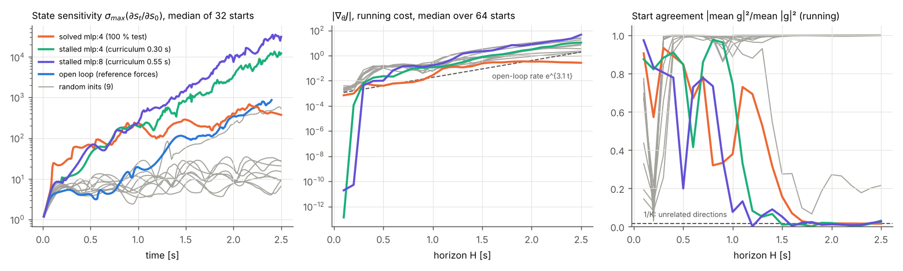
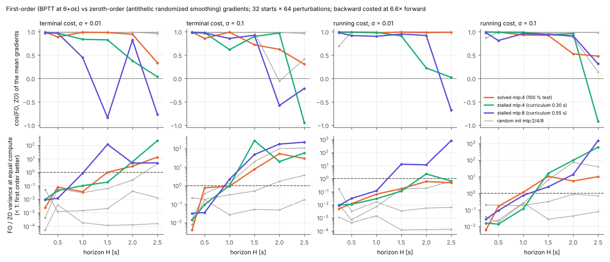

# Do simulator gradients help find tiny swing-up controllers on a chaotic system?

**Question.** For tiny tanh controllers (mlp:2, mlp:4, mlp:8; 23, 45 and 89 parameters) on the
cart-double-pendulum swing-up, when do analytic first-order gradients through the simulator beat
zeroth-order search (CMA-ES, randomized smoothing) at equal compute? How does chaos limit them?

The task, the 256 test starts and the success definition are unchanged (`docs/TASK_AND_EVALUATION.md`).
Velocity observation scale is 12 throughout. Surrogate objectives are used only for training and
diagnostics; success is always measured by the numba kernel.

**Status (2026-10-31).** Steps 1–3 are done: literature review, a verified JAX port, and gradient
diagnostics. The brief says to stop here and report. Steps 4–6 (training comparison on GitHub
Actions) are not started; see [Next steps](#next-steps).

Work is on branch `claude/vigilant-thompson-548nni`, the branch this session was assigned. It
replaces the requested `research/diffsim` and is based on `claude/modest-carson-qx8ce5`.

---

## 1. Literature review

All citations were checked against arXiv, PMLR, OpenReview and NeurIPS listings through web
search. The session could not open full texts, so the claims below are at abstract or summary
level. Anything I could not confirm is marked *unverified*.

| Paper | What it shows that matters here |
|---|---|
| Suh, Simchowitz, Zhang, Tedrake. *Do differentiable simulators give better policy gradients?* ICML 2022, arXiv:2202.00817 | For smooth, Lipschitz systems the first-order (FO) estimator has lower variance and wins. FO can do worse than the zeroth-order (ZO, randomized-smoothing) estimator in three cases: stiffness (large gradient norms inflate variance), near-discontinuities ("empirical bias" that sample variance does not reveal), and chaos (their double-pendulum example, where ZO dominates). They propose an α-order estimator that interpolates between FO and ZO using a confidence-interval test. |
| Metz, Freeman, Schoenholz, Kachman. *Gradients are not all you need.* arXiv:2111.05803, 2021 (preprint) | Traces a single failure mode across RNNs, rigid-body physics and learned optimisers to the spectrum of the system Jacobian. If any eigenvalue magnitude exceeds 1, gradients or their variance explode, and training can push the system into that regime. Remedies: truncation (biased) or black-box/ES gradients (cost grows with dimension). |
| Xu, Makoviychuk, Narang, Ramos, Matusik, Garg, Macklin. *Accelerated policy learning with parallel differentiable simulation* (SHAC). ICLR 2022, arXiv:2204.07137 | Short BPTT windows (e.g. 32 steps) plus a terminal value critic and many parallel environments. The truncated objective is much smoother and avoids exploding gradients. Large sample-efficiency and wall-clock gains over PPO and SAC on CartPole swing-up, Ant, Humanoid and a muscle humanoid. |
| Parmas, Rasmussen, Peters, Doya. *PIPPS.* ICML 2018, arXiv:1902.01240 | Names the "curse of chaos": over long nonlinear rollouts, pathwise (reparameterisation) gradients explode and their direction becomes essentially random, while likelihood-ratio gradients stay usable. Inverse-variance weighting of the two ("total propagation") fixes this. |
| Mikhaeil, Monfared, Durstewitz. *On the difficulty of learning chaotic dynamics with RNNs.* NeurIPS 2022, arXiv:2110.07238 | Proves that loss gradients diverge whenever the trained dynamics are chaotic (λ_max > 0) and stay bounded for fixed-point or cyclic dynamics. Proposes sparsely forced BPTT, with a forcing interval tied to the predictability time ~ln 2/λ_max. |
| Georgiev, Srinivasan, Xu, Heiden, Garg. *Adaptive Horizon Actor-Critic* (AHAC). ICML 2024, arXiv:2405.17784 | Adapts SHAC's horizon to avoid stiff contact. First-order gradients have low variance but are biased under stiffness. |
| Antonova, Yang, Jatavallabhula, Bohg. *Rethinking optimization with differentiable simulation from a global perspective.* CoRL 2022, arXiv:2207.00167 | Even exact gradients face many local optima and plateaus, so they combine global (Bayesian-optimisation) search with local gradients. |
| Son et al. *Gradient informed PPO.* NeurIPS 2023, arXiv:2312.08710 | Mixes analytic gradients into PPO and down-weights them when their measured variance or bias is high. |
| Suh, Pang, Tedrake. *Bundled gradients through contact via randomized smoothing.* RA-L 2022, arXiv:2109.05143 | Gradients averaged over a neighbourhood (FO or ZO) beat exact gradients through contact. |
| Song, Kim, Scaramuzza (CoRL 2024, arXiv:2403.14864); Schwarke et al. (arXiv:2404.02887, CoRL 2025) | Quadruped locomotion trained with differentiable simulation in minutes, more sample-efficient than PPO. |
| Onoda, Parmas, Yaguchi, Matsuo. *Does "Do differentiable simulators give better policy gradients?" give better policy gradients?* ICLR 2026, arXiv:2604.18161 (listing checked only) | Finds the α-order test noisy and wasteful and proposes simpler FO/ZO switching and per-step inverse-variance weighting. Concludes that variance control matters more than discontinuity bias in realistic tasks. |
| Gillen, Byl. *Leveraging reward gradients for RL in differentiable physics simulations.* arXiv:2203.02857 (venue unverified) | Closest swing-up precedent. On Acrobot swing-up, plain analytic policy gradients got stuck. A cross-entropy outer search around gradient updates succeeded. |
| Florensa et al. *Reverse curriculum generation.* CoRL 2017, arXiv:1707.05300 | Start-state curriculum, the one our CMA-ES runs use. |

**What is already known.**
* Under chaos (λ_max > 0), BPTT gradient norms grow like e^{λT} with horizon and their direction becomes random (Metz; Mikhaeil; PIPPS). FO variance can therefore exceed ZO variance (Suh et al.'s double pendulum).
* Stiffness inflates FO variance, and near-discontinuities bias FO estimates without showing up in their variance.
* Truncation, short windows with a critic, and forcing restore usable gradients at the cost of bias (SHAC, AHAC, sparse forcing).
* Mixing FO and ZO estimators beats either alone (α-order, PIPPS, GI-PPO, Onoda et al.).
* Gradients are local, and global search is still needed on multimodal landscapes (Antonova; Gillen & Byl).

**What this benchmark adds.** I found no study that does any of the following:
* compares BPTT with CMA-ES at equal compute for **tiny** controllers (tens of parameters). At this size ZO's dimension penalty is small, which could reverse the usual large-network conclusion;
* isolates chaos in a **smooth, contact-free** underactuated swing-up as a policy-learning benchmark. Suh's double pendulum is an illustration of estimator variance, and SHAC/AHAC target contact and stiffness;
* evaluates on a **sparse success criterion** with a hold horizon (20 s) far beyond the predictability time (~0.3 s here);
* studies how a **start-state curriculum** interacts with either estimator;
* measures gradient quality as a function of **the controller's own closed-loop stability** along training, not only of the open-loop system. This is the main point of the diagnostics below.

---

## 2. JAX port (`pendulum/jax_sim.py`, `tests/test_jax_port.py`)

`physics_step`, the observation and the policy forward pass are reimplemented in JAX with float64
on CPU. Rollouts use `jax.lax.scan` and are batched over starts with `vmap`. The arithmetic follows
the numba kernel expression by expression, with bias-first, left-to-right accumulation in the
network. Episode termination and the sparse score are not ported; the numba kernel stays the only
judge of success.

| Check (`python -m pytest -q tests/test_jax_port.py`, 12 tests) | Result |
|---|---|
| One physics step, 200 random states, two physics settings | ≤ 1e-13 |
| 2 s closed-loop trajectories (states and actions), solved controller + 6 random mlp:2/4/8, 6 starts each | ≤ 1.5e-11 measured; test tolerance 1e-9 |
| Policy outputs, 2000 random observations × 7 policies, `exact=True` | **bit-identical** to the numba `_forward` |
| Same, fast default mode (used for gradients) | within 1.3e-14 (a few ulp) |
| Reverse-mode gradient vs central differences, 0.5 s rollout | rel. 1e-5 |

The fast mode differs by a few ulp for two reasons. XLA fuses multiply-adds into FMA, and its
`tanh` is not libm's. `exact=True` blocks the fusion with `optimization_barrier` and calls libm
`math.tanh` on the host, which makes the outputs bit-identical. Note that NumPy's `np.tanh` is
*not* bit-identical to libm. Exact mode is slow and is used only for verification.

**Cost of a gradient** (`diag/timing.json`, this 4-vCPU container, 64 starts × 2.5 s): a forward
pass runs at 2.5–3.5 M env steps/s, and forward + backward costs **5.4× (mlp:2), 7.8× (mlp:4) and
6.7× (mlp:8)** a forward pass, 6.6× on average. A dense-matrix forward pass was no faster. The
numba kernel runs about 3.2 M steps/s per core. For step 5 the ratio must be re-measured on the
Actions runner.

---

## 3. Diagnostics before training (`diffsim/diagnostics.py`, plots: `diffsim/plot_diagnostics.py`)

**Policies.**
* The solved controller (`revcurr_mlp4_s0_v12`, 100 % test).
* Two controllers from stalled curricula: mlp:4 seed 1, which stalled with starts 0.30 s into the swing-up (1.2 % test), and mlp:8 seed 0, stalled at 0.55 s (1.6 % test).
* Nine random initialisations (mlp:2/4/8 × seeds 0–2), identical to CMA-ES's starting point.

**Starts.** The task's distribution (hanging rest ±0.05), drawn from a diagnostic seed that is
neither validation nor test.

**Objectives** (`pendulum/jax_objectives.py`):
* `term`: terminal state cost c(s_H). The cost c is 0 when upright at rest at the track centre and about 1 when hanging, built from 1 − cos terms (smooth everywhere) plus small x² and v² terms.
* `run`: running cost, the mean of c(s_k) over the horizon.
* `soft`: −(mean sigmoid upright indicator) at temperature 0.005, a relaxation of the sparse score.

### 3a. Chaos and gradient norm vs horizon



| Policy | σ_max(∂s/∂s₀) at 2 s | its growth rate [1/s] | \|∇J_run\| rate [1/s] | \|∇J_term\| rate [1/s] | start agreement at 0.5 / 1 / 1.5 / 2.5 s (1 = all starts agree, 1/64 = unrelated) | soft-score gradient non-zero |
|---|---|---|---|---|---|---|
| open loop, reference forces | 344 | **3.08** | | | | |
| solved mlp:4 | 401 | 0.94 (flat after 1 s) | 2.28 | 1.29 | 0.85 / 0.38 / 0.16 / 0.02 | 100 % of starts |
| stalled mlp:4 | 3,460 | 2.82 | 3.21 | 3.72 | 0.85 / 0.74 / 0.01 / 0.03 | 48 % |
| stalled mlp:8 | 7,450 | 3.41 | 3.57 | 4.10 | 0.20 / 0.08 / 0.05 / 0.03 | 78 % |
| random mlp:2/4/8 (9) | 8–220 | 0.10–2.55 | 1.3–3.2 | 0.6–3.5 | 0.89–1.00 / … / 0.21–1.00 at 2.5 s | **0 %** |

Rates are least-squares slopes of log(median) over 0.5–2.5 s (open loop: 0.5–2.0 s).

Reproducing the documented chaos measurement: a 1e-3 start error under open-loop replay of the
reference forces grows **89×** in position error by 2 s (median of 32 draws). `docs/DIAGNOSIS.md`
reports ~50× from a different draw. The linearised growth σ_max is 344× at 2 s, a rate of
3.1/s, so the predictability time 1/λ is about 0.32 s.

**Findings.**
1. **Gradient norms grow at the chaos rate for controllers that swing up.** For both stalled
   controllers the closed loop is as chaotic as the open loop (2.8–3.4/s against 3.1/s), and
   \|∇J\| grows at 3.2–4.1/s. Between 1.0 and 1.5 s the per-start gradients stop agreeing and fall
   to the level of unrelated directions (1/K). From there on, a batch gradient over 64 starts is
   mostly noise.
2. **The solved controller is different. Its closed loop stops expanding after ~1 s** (σ_max flat
   at ~400): a feedback funnel. Its gradient norm still grows, but slower (1.3–2.3/s), and its
   start agreement also falls to ~0.02 by 2 s. Gradients of a *good* controller are therefore
   informative only for local refinement (section 3b).
3. **Random initialisations have well-behaved gradients that are useless for the task.** All
   starts agree (SNR ≈ 1 to 2.5 s) and the closed loop barely expands, because a random network
   never leaves the hanging basin. Their gradient norms grow at 1.3–3.2/s even without chaos. My
   reading, not separately measured: the x² and v² cost terms grow as the cart drifts 7–40 m.
   The **sparse-score relaxation has exactly zero gradient at every random initialisation**: no
   state comes near upright, and the sigmoid tails underflow at temperature 0.005. Surrogate (a)
   therefore needs either a high initial temperature or the start-state curriculum.

### 3b. First-order vs zeroth-order gradients

For each policy, horizon H ∈ {0.25, 0.5, 1, 1.5, 2, 2.5 s} and smoothing σ ∈ {0.01, 0.1}, I drew
32 starts × 64 perturbations, with an independent ε for every sample:
* FO: ∇J_i(θ+σε), a BPTT gradient of the smoothed objective;
* FO0: ∇J_i(θ), plain BPTT;
* ZO: antithetic randomized smoothing, (J_i(θ+σε) − J_i(θ−σε))/(2σ)·ε.

A first version shared each ε across all starts. That left only 64 directions in 45 dimensions,
biased the ZO mean by ~√(P/M), and a split-half check did not catch it. It was fixed before the
results below. The equal-compute variance ratio charges an FO sample 6.6 forward rollouts and an
antithetic ZO sample 2.



Each cell is cos(FO, ZO) of the mean gradients / FO-to-ZO variance ratio at equal compute
(< 1 means FO is cheaper for the same accuracy). Running cost:

| Policy, σ | 0.5 s | 1.0 s | 1.5 s | 2.0 s | 2.5 s |
|---|---|---|---|---|---|
| solved, σ=0.01 | +0.99 / 0.012 | +0.98 / 0.065 | +0.99 / 0.17 | +0.99 / 0.6 | +0.99 / 0.49 |
| solved, σ=0.1 | +0.99 / 0.17 | +0.93 / 1.2 | +0.92 / 11 | +0.52 / 5.5 | +0.48 / 10 |
| stalled mlp:4, σ=0.01 | +0.99 / 0.011 | +0.98 / 0.029 | +0.91 / 0.11 | +0.22 / 2.3 | +0.02 / 0.66 |
| stalled mlp:4, σ=0.1 | +0.99 / 0.014 | +0.99 / 0.12 | +0.93 / 16 | +0.96 / 98 | −0.92 / 610 |
| stalled mlp:8, σ=0.01 | +0.92 / 0.03 | +0.90 / 0.12 | +0.95 / 13 | +0.92 / 11 | −0.68 / 820 |
| stalled mlp:8, σ=0.1 | +0.81 / 0.091 | +0.96 / 0.75 | +0.94 / 2.5 | +0.91 / 14 | +0.31 / 1500 |
| random mlp:4 s0, σ=0.1 | +0.99 / 0.19 | +0.99 / 0.18 | +0.99 / 0.32 | +0.99 / 0.87 | +0.99 / 0.72 |
| random mlp:8 s0, σ=0.1 | +0.98 / 0.025 | +0.97 / 0.27 | +0.97 / 0.028 | +0.98 / 0.043 | +0.98 / 0.079 |

Terminal cost behaves the same way but breaks down earlier. For example, the solved controller at
σ = 0.01 has an equal-compute ratio of 1.0 at 1.5 s and 13 at 2.5 s. All cells:
`diag/cosine_*.json`.

**Findings.**
4. **Up to ~1 s both estimators measure the same gradient (cos ≥ 0.9), and FO is 10–100× cheaper**
   at equal compute for every controller. That covers about three Lyapunov times.
5. **Beyond ~1.5 s, for controllers that swing up, FO loses.** Its per-sample variance exceeds
   ZO's at equal compute by up to ~10³×. Its split-half self-cosine drops to ≤ 0, which means
   heavy tails: a few samples dominate the mean. The cosine with ZO falls toward 0 or below. This
   is the Suh et al. / PIPPS picture, now measured on the controllers our search actually produces.
6. **Smoothing scale decides it.** With σ = 0.01 the solved controller's running-cost FO gradient
   stays consistent and cheaper all the way to 2.5 s, because all perturbed controllers still lie
   in its funnel. With σ = 0.1 (CMA-ES's typical step is larger, sigma0 = 0.5) it breaks down after
   1 s.
7. Plain FO0 and smoothed FO agree wherever FO is reliable. Where they disagree (e.g. terminal
   cost at ≥ 1.5 s), neither agrees with ZO.

### Answer to the step-2/3 question

Gradients are informative at swing-up horizons **only for short windows (≤ ~1 s ≈ 3/λ) or near a
controller that already has a feedback funnel**. Across the full 2.5 s swing-up, for the controllers
where CMA-ES actually stalls (closed loop as chaotic as the open loop), first-order gradients are
noise: start agreement ≈ 1/K, heavier-tailed and up to 10³× more variable than randomized smoothing
at equal compute. At random initialisation, gradients are clean but point toward dense-cost
minimisers, and the sparse relaxation gives none.

**Predictions for step 6.**
* Full-horizon BPTT from rest will stall once the policy starts swinging.
* Truncated or short-horizon BPTT (windows ≤ 1 s) and BPTT inside the start-state curriculum
  (segments ≤ 1 s, terminal cost at the segment end, surrogate b) are the arms where gradients
  should win.
* The hybrid (CMA-ES, then small-σ gradient refinement) should help robustness or speed only once
  CMA-ES has found a funnel.

These are hypotheses, not results.

---

## Next steps

Steps 4–6 have not started. The design follows the diagnostics:
* surrogates (a) soft sparse score with temperature annealed from ~0.1 toward 0.005, (b) segment
  terminal cost in the start-state curriculum, (c) energy + upright dense reference (labelled as such);
* methods at equal budget, counting env steps with backward passes charged at the runner's measured
  ratio (~6.6× here);
* `.github/workflows/diffsim.yml` (tags `diff-*` + dispatch, `max-parallel: 5`, artifacts), smoke-tested first;
* size ladder × methods × 3 seeds;
* hyperparameters tuned on validation with equal tuning budgets.

| Tag | Run ID | Commit | Status |
|---|---|---|---|
| — | — | — | no Actions runs launched yet |

## Files

| Path | Contents |
|---|---|
| `pendulum/jax_sim.py` | JAX port (physics, observation, policy, `scan` rollouts, `exact` mode) |
| `pendulum/jax_objectives.py` | differentiable surrogates (state cost, soft upright indicator) |
| `tests/test_jax_port.py` | equivalence tests against the numba kernel |
| `diffsim/diagnostics.py` | `chaos`, `gradnorm`, `cosine [names]`, `timing` sections |
| `diffsim/plot_diagnostics.py` | figures |
| `results/diffsim/diag/*.json` | raw diagnostic data |

Reproduce, from the repository root:

```bash
pip install "jax[cpu]" optax
```

```bash
python -m pytest -q tests/test_jax_port.py
```

```bash
for s in chaos gradnorm timing; do python diffsim/diagnostics.py $s; done
```

```bash
python diffsim/diagnostics.py cosine solved; python diffsim/diagnostics.py cosine stalled; python diffsim/diagnostics.py cosine random
```

```bash
python diffsim/plot_diagnostics.py
```

Wall time on this container: chaos ≈ 1 min, gradnorm ≈ 2 min, each cosine group ≈ 2–5 min.
